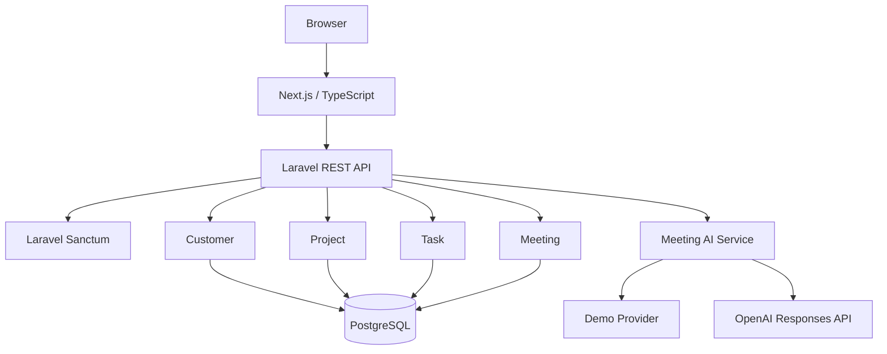

# SalesFlow AI

営業活動における顧客・案件・タスク・商談情報を一元管理する、個人開発のCRM Webアプリケーションです。

LaravelによるREST APIとNext.jsによるFrontendを分離した構成とし、認証・CRUD・ダッシュボード・AI営業支援機能に加え、テスト、Security Audit、CI、Dependabotまで含めた継続的な開発・運用を意識して実装しています。

## プロジェクト概要

SalesFlow AIでは、営業担当者が日常的に扱う以下の情報を一つのシステムで管理できます。

- 顧客情報
- 営業案件
- タスク
- 商談・打ち合わせ
- ダッシュボードによる進捗確認
- AIによる商談結果・次回対応案の提案

単純なCRUDアプリケーションだけではなく、認証・データ所有権・AI API連携・外部APIコスト管理・Rate Limit・自動テスト・Security Audit・CIまで含めて設計しています。

## 開発目的

Webアプリケーション開発に必要となるFrontend / Backend / Database / Authentication / Test / Security / CIを一通り実装し、個人開発として継続的に改善・運用できるシステムを構築することを目的としています。

特に以下を意識しています。

- FrontendとBackendの責務分離
- REST APIを利用したデータ連携
- Login User単位のデータ所有権管理
- 外部AI APIへ直接依存しすぎない設計
- AI提案を人間が確認してから保存するHuman-in-the-loop
- API利用料金を考慮したDemo Provider
- 既知脆弱性への継続的な対応
- Pull Request単位での自動品質チェック

## 主な機能

### Authentication

Laravel Sanctumを利用したSession / Cookieベースの認証を実装しています。

- Login
- Logout
- Login User取得
- 未認証UserからのAPIアクセス制御

### Customer

営業活動の起点となる顧客情報を管理します。

- 顧客一覧
- 顧客登録
- 顧客詳細
- 顧客編集
- 顧客削除
- 顧客単位の案件・活動情報表示
- Login Userごとの所有権制御

### Project

顧客に紐づく営業案件を管理します。

- 案件一覧
- 案件検索
- Status Filter
- 案件登録
- 案件詳細
- 案件編集
- 案件削除
- 顧客との関連付け
- 案件単位のTask / Meeting表示

### Task

営業案件に紐づくタスクを管理します。

- Task一覧
- 検索
- Filter
- 登録
- 編集
- 削除
- 完了状態管理
- 完了日時管理
- Login Userの案件以外へのアクセス防止

### Meeting

営業案件に紐づく商談・打ち合わせを管理します。

- Meeting一覧
- 検索
- Filter
- 登録
- 編集
- 削除
- Scheduled / Completed / CancelledのStatus管理
- 対面 / Online / 電話などの商談方法管理
- 商談結果
- 次回対応
- 完了日時管理

### Dashboard

営業活動全体の状況を確認できるDashboardを実装しています。

Customer / Projectに加えて、Task・Meetingの集計情報や直近予定を表示します。

## Meeting AI Assistant

商談内容から、営業担当者向けに以下を提案するAI支援機能を実装しています。

- 商談結果の要約案
- 次回対応案

AIがMeetingを直接更新することはありません。

```text
User
 ↓
Meeting Form
 ↓
AI提案Request
 ↓
AI Provider
 ↓
result / nextAction Proposal
 ↓
Userが内容を確認・修正
 ↓
通常のMeeting保存API
```

AIが生成した内容をそのままDatabaseへ保存せず、Userが確認してから保存するHuman-in-the-loop構成にしています。

## AI Provider設計

Meeting AIは特定のAI ProviderへControllerが直接依存しない構成にしています。

```text
MeetingAiSuggestionController
        ↓
MeetingAiSuggestionService
        ↓
MeetingAiSuggestionProvider
        │
        ├─ DemoMeetingSuggestionService
        │
        └─ OpenAiMeetingSuggestionService
```

環境変数によってProviderを切り替えられます。

### Demo Provider

```env
MEETING_AI_ENABLED=true
AI_PROVIDER=demo
```

外部AI APIへ通信せずDemo提案を生成します。

公開Portfolio環境でOpenAI API利用料金を継続的に発生させないことを目的としています。

### OpenAI Provider

```env
MEETING_AI_ENABLED=true
AI_PROVIDER=openai
```

OpenAI Responses APIを利用してStructured Output形式で、

- `result`
- `nextAction`

を取得します。

OpenAI API KeyはFrontendへ公開せず、Laravel Backendからのみ利用します。

### AI機能停止

```env
MEETING_AI_ENABLED=false
```

AI提案機能自体を停止することも可能です。

## AI Rate Limit

Meeting AI APIにはLogin User単位のRate Limitを設定しています。

デフォルト:

```text
5 requests / minute / user
```

設定値は環境変数で変更できます。

```env
MEETING_AI_RATE_LIMIT_PER_MINUTE=5
```

これにより、公開環境での過剰Request抑制と、OpenAI Provider利用時のAPIコスト増加防止を行います。

## Architecture



## Domain構成

主なDomainの関連は以下です。

```text
User
 └─ Customer
      └─ Project
           ├─ Task
           └─ Meeting
```

TaskやMeetingに直接`user_id`を持たせるのではなく、Project → Customer → Userの関連から所有権を判定する構成にしています。

これにより、異なるUserのCustomer / Project / Task / MeetingへアクセスできないようAPI側で制御しています。

## Technology Stack

### Frontend

- Next.js 16
- React 19
- TypeScript
- Tailwind CSS
- Lucide React
- App Router

### Backend

- PHP 8.3
- Laravel 13
- Laravel Sanctum
- Laravel Pint
- PHPUnit

### Database

- PostgreSQL
- SQLite `:memory:` for automated tests

### AI

- OpenAI Responses API
- Structured Outputs
- Demo AI Provider
- Provider abstraction

### Development / Operations

- Git
- GitHub
- GitHub Actions
- Dependabot
- WSL2
- Ubuntu 24.04 LTS

## Security

Security面では以下の対策を行っています。

- Laravel Sanctumによる認証
- Login User単位のデータ所有権確認
- Laravel FormRequestによる入力Validation
- OpenAI API KeyのBackend管理
- `.env`によるSecret管理
- AI APIへのRate Limit
- OpenAI Error詳細をClientへ直接公開しないError Handling
- `composer audit`によるPHP Dependency監査
- `npm audit`によるFrontend Dependency監査
- PHP RuntimeおよびDependencyのSecurity Update
- Dependabotによる継続的なDependency Update確認

既知脆弱性が確認された場合には、影響Versionの調査、修正版へのUpdate、Security Audit、Regression Testまで実施する運用としています。

## Automated Tests

LaravelのUnit / Feature Testを実装しています。

現在のBackend Test結果:

```text
91 tests passed
377 assertions
```

主な確認対象:

- Authentication
- Customer API
- Project API
- Task API
- Meeting API
- Dashboard API
- Userごとのデータ所有権
- Meeting AI API
- Demo AI Provider
- OpenAI Provider
- OpenAI Error Handling
- AI Feature Disable
- Unsupported Provider
- AI Rate Limit

AI TestではLaravelの`Http::fake()`を使用し、Test実行時に実際のOpenAI APIへ通信しない構成にしています。

## CI

GitHub Actionsを利用してPull Requestおよび`main`へのPush時に自動検証を実行しています。

### Backend CI

```text
composer install
      ↓
composer validate
      ↓
composer audit
      ↓
Laravel Pint
      ↓
Laravel Test
```

### Frontend CI

```text
npm ci
  ↓
npm audit
  ↓
TypeScript
  ↓
ESLint
  ↓
Next.js Production Build
```

Backend / Frontendを独立したJobとして実行し、どちらかに問題があればMerge前に確認できる構成です。

## Dependabot

以下のDependencyをDependabotで定期監視しています。

- Composer
- npm
- GitHub Actions

更新確認は毎週月曜日09:00（Asia/Tokyo）に実行します。

minor / patch Updateはパッケージエコシステム単位でまとめ、major Updateは影響範囲を確認できるよう個別に扱います。

Dependabotによって作成されたPull RequestについてもGitHub Actions CIを実行し、Test・Build・Security Auditを確認してからMergeします。

自動Mergeは使用せず、人間が変更内容とCI結果を確認してからMergeする運用としています。

## Environment Variables

### Backend

AI関連の主な環境変数:

```env
MEETING_AI_ENABLED=true
AI_PROVIDER=demo
MEETING_AI_RATE_LIMIT_PER_MINUTE=5

OPENAI_API_KEY=
OPENAI_MODEL=gpt-6-luna
OPENAI_BASE_URL=https://api.openai.com/v1
```

公開Demoでは`AI_PROVIDER=demo`を想定しています。

OpenAI APIを使用する場合のみ`AI_PROVIDER=openai`へ変更し、Backend環境へAPI Keyを設定します。

### Frontend

Local開発環境では以下を使用します。

```env
NEXT_PUBLIC_BACKEND_URL=http://localhost:8000
NEXT_PUBLIC_API_BASE_URL=http://localhost:8000/api/v1
NEXT_PUBLIC_FRONTEND_URL=http://localhost:3000
```

## Local Setup

### Backend

```bash
cd backend

composer install

cp .env.example .env

php artisan key:generate

php artisan migrate

php artisan serve --host=localhost --port=8000
```

Database設定については利用環境に合わせて`.env`を設定します。

### Frontend

別Terminalで実行します。

```bash
cd frontend

npm ci

npm run dev
```

Local URL:

```text
Frontend
http://localhost:3000

Backend
http://localhost:8000
```

SanctumのCookie / Session認証を利用するため、Local開発ではFrontend / Backendとも`localhost`へ統一しています。

## Quality Check

### Backend

```bash
cd backend

composer validate

composer audit

./vendor/bin/pint --test

php artisan test
```

### Frontend

```bash
cd frontend

npm audit

npx tsc --noEmit

npm run lint

npm run build
```

## 工夫した点

### 1. Frontend / Backendの責務分離

Next.jsとLaravelを分離し、FrontendからLaravel REST APIを利用する構成にしています。

### 2. データ所有権

単にLogin済みか確認するだけではなく、Customer → Project → Task / Meetingの関連を利用し、Login User以外のデータへアクセスできないようにしています。

### 3. AIを自動保存しない設計

AIはあくまで営業担当者を支援する提案機能として扱い、AI ResponseをDatabaseへ直接保存しません。

営業担当者自身が内容を確認・修正してから保存します。

### 4. AI APIコストへの対応

公開Portfolioで継続的なOpenAI API利用料金が発生しないよう、Demo Providerを実装しています。

必要な環境ではEnvironment VariableだけでOpenAI Providerへ切り替えられます。

### 5. Securityを開発フローへ組み込む

脆弱性が発見された場合だけ手動対応するのではなく、

```text
Dependabot
     ↓
Pull Request
     ↓
GitHub Actions
     ↓
Security Audit
     ↓
Test / Build
     ↓
Human Review
     ↓
Merge
```

という継続的な運用を構築しています。

## 今後の改善予定

今後は以下を予定しています。

- 公開Demo環境の構築
- Demo Account / Demo Dataの整備
- READMEへの画面キャプチャ追加
- 営業活動タイムライン機能
- Dashboard / Report機能の強化
- Deployment環境での監視・Logging強化
- E2E Testの導入

## About This Project

SalesFlow AIは、Web Applicationの設計・実装だけでなく、Test、Security、CI、Dependency Management、AI APIの運用コストまで含めた開発経験を積むことを目的として継続開発している個人プロジェクトです。
